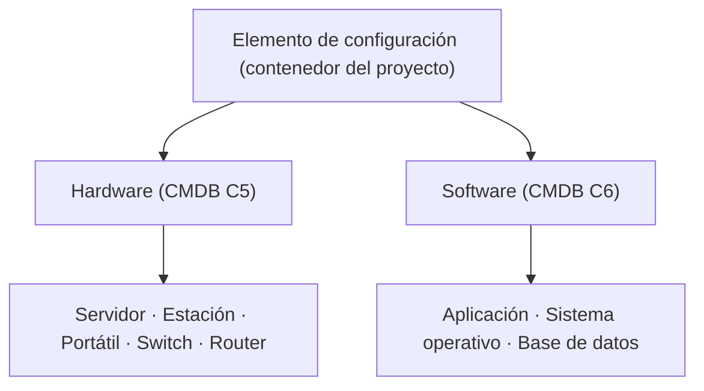
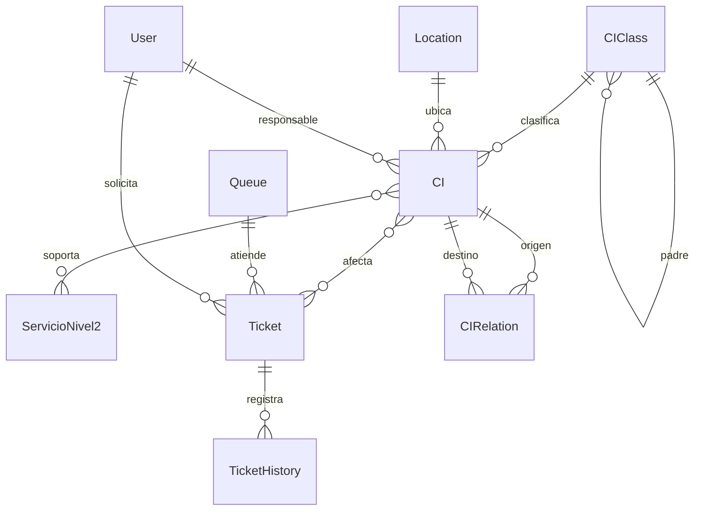

# Modelo de datos, jerarquía CMDB y trazabilidad

## Fuentes sin modificar

| Fuente | Elementos verificables | Implementación |
|---|---|---|
| `data/CatalogoServicios.xlsx` | 12 N1, 46 N2, SE.12 y campos auxiliares | `apps/catalog`, `apps/imports` |
| `docs/fuentes/CMDB.xlsx`, hoja `CMDB`, B4:U4 | 20 encabezados, ejemplos fila 5 y 6 | `apps/cmdb/models.py` |
| `docs/fuentes/Transicion.pptx.pdf`, diapositiva 14 | SACM: SKMS, CMS, CMDB, KEDB | CMDB para CI + asociaciones, no replica una jerarquía de subtipos ausente |
| `docs/fuentes/Service Desk.pptx.pdf`, diapositivas 11 a 16 | niveles, tipos, eventos e incidentes | `apps/service_desk` |
| PDF de tarea | reglas nuevas de 5,000 dispositivos y pruebas | `seed_cmdb`, modelos, vistas, tests |

## Jerarquía original contrastada

`CMDB.xlsx` **no** contiene un árbol de clases con múltiples niveles enumerados; en C5 figura
`Hardware` y en C6 `Software`. La diapositiva 14 de la lección 22 organiza sistemas de
conocimiento (`SKMS → CMS → CMDB/KEDB`), no categorías de dispositivos. Por tanto:

Las subclases y el nodo contenedor son **decisiones de implementación**, no transcripciones
de la fuente. El campo `CIClass.source` diferencia `EXCEL` y `PROYECTO`.
La jerarquía organizacional `Empresa → Área → Departamento → Sección → Puesto → Usuario`
continúa por separado. `CIClass.parent` rechaza ciclos y padres inexistentes mediante FK.

## Diccionario de los 20 campos originales

| Excel | Encabezado normalizado | Base de datos / representación |
|---|---|---|
| B4 | Nombre del CI | `CI.name` |
| C4 | Tipo de CI | `CI.classification` → `CIClass` |
| D4 | Descripción | `CI.description` |
| E4 | Número de serie | `CI.serial_number` (opcional) |
| F4 | Versión | `CI.version` |
| G4 | Fecha de adquisición | `CI.acquired_on` (opcional) |
| H4 | Estado actual | `CI.status` |
| I4 | Relaciones | `CIRelation` |
| J4 | Padres/Hijos | `CIClass.parent` para clases; `CIRelation` para dependencia técnica entre CI |
| K4 | Ubicación física | `CI.location` → `Location` |
| L4 | Propietario/Responsable | `CI.owner` → `User` |
| M4 | Fecha de cambio | `CI.last_changed_on` |
| N4 | Descripción del cambio | `CI.change_description` |
| O4 | Documentación relacionada | `CI.documentation` |
| P4 | Enlaces a incidentes y problemas | `CI.tickets` → `Ticket` (filtro incidente/problema) |
| Q4 | Niveles de seguridad | `CI.security_level` |
| R4 | Cumplimiento | `CI.compliance` |
| S4 | Estado de configuración | `CI.configuration_status` |
| T4 | Número de licencia | `CI.license_number` (opcional) |
| U4 | Fecha de vencimiento | `CI.expires_on` (opcional) |

**Diferencias no ocultas:** los datos de J4 son texto de encabezado, sin estructura
jerárquica definida; el modelo proporciona un árbol tipado para clasificación y relaciones
dirigidas entre equipos. La fuente no proporciona una lista exhaustiva de estados o valores
de campos. `code`, `attributes` JSON, `created_at`, `updated_at`, `services`, `tickets`,
`source`, `is_device` y el catálogo `Location` son campos adicionales del proyecto.
Las direcciones IP solo existen en `attributes` de clases donde tienen sentido.

## Entidades y claves

`Ticket` deriva su N1 a través de `ServicioNivel2.nivel1`. `EventIncident` vincula
evento e incidente por relaciones uno a uno, y `DeskNotification` conserva el aviso interno.

## Grafo técnico distinto del árbol

- `DEPENDE_DE` y `ALOJADO_EN`: dirigidas y acíclicas. La validación recorre el destino
  antes de agregar la arista y rechaza una ruta de regreso al origen.
- `CONECTADO_A`: dirigida; puede formar anillos o redes físicas malladas.
- Consulta de impacto: desde el CI posiblemente fallido, recorrer **inversamente** las
  dependencias/alojamientos hasta los consumidores; recuperar servicios de esos CI.
  Esta consulta identifica **posibles** afectaciones, no asegura una interrupción real.

## Generación y cantidades

`python manage.py seed_cmdb --seed 201700866 --count 5000` construye un conjunto de
códigos `CI-201700866-000001` a `CI-201700866-005000` con `random.Random(seed)`.
El generador distribuye 1,000 dispositivos en cada subclase física, sin contar clases ni
software. Vincula cada dispositivo a un servicio existente y crea 11 relaciones
técnicas de muestra (incluido un anillo permitido de `CONECTADO_A`). Idempotencia: omite códigos
existentes del mismo conjunto; no borra ni actualiza otros dispositivos.
