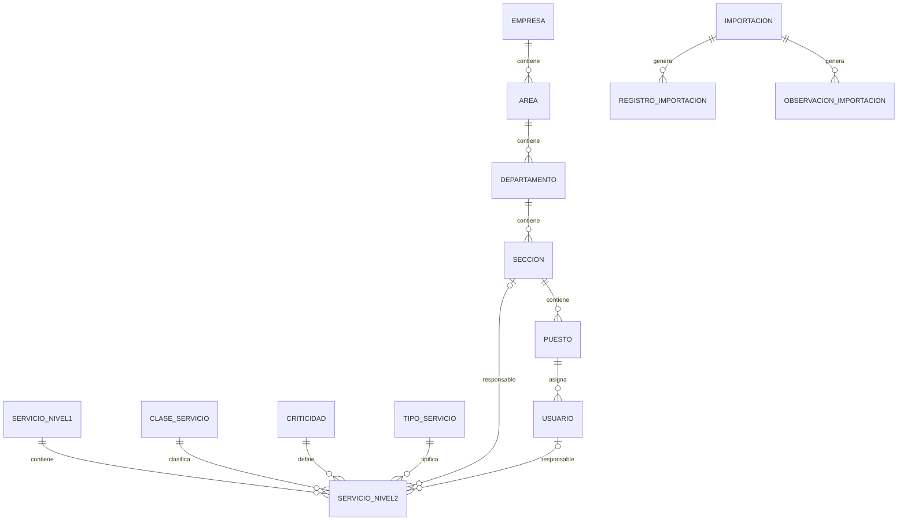

# Resolución - Catálogo de Servicios TI

## Autor del proyecto

**Erick Noe Gómez López**

Carné: `201700866`

El proyecto es individual.

El autor realizó:

- análisis del problema;
- diseño de arquitectura;
- modelo de datos;
- implementación;
- importación;
- autenticación y autorización;
- pruebas;
- Docker;
- documentación;
- validación final.

La IA se utilizó como herramienta de apoyo bajo revisión y decisión humana.

---
## 1. Problema y alcance

El proyecto sistematiza un catálogo de servicios de TI originalmente suministrado en `CatalogoServicios.xlsx`.

Además del catálogo, administra:

- estructura organizacional;
- usuarios;
- roles;
- responsables de servicios;
- valores maestros;
- importaciones y trazabilidad.

El sistema no implementa:

- tickets;
- facturación;
- consumo;
- mesa de ayuda;
- cobros.

El Excel entregado funciona como referencia estructural o machote.

Los valores 12 N1 y 46 N2 son controles del archivo original, no límites del sistema.

---

## 2. Arquitectura

La solución utiliza una arquitectura monolítica Django.

Componentes:

- navegador web;
- Django Templates;
- vistas y formularios Django;
- modelos Django ORM;
- PostgreSQL;
- importador openpyxl;
- Docker Compose.

Flujo general:

    Navegador
        |
        v
    Django
        |
        +---- Autenticación y autorización
        |
        +---- Organización
        |
        +---- Usuarios
        |
        +---- Catálogo
        |
        +---- Importador Excel
        |
        v
    PostgreSQL

Ventajas para este proyecto:

- menor complejidad de despliegue;
- sesiones y autenticación integradas;
- ORM y migraciones;
- formularios con validación de servidor;
- ejecución reproducible mediante contenedores.

---

## 3. Modelo de datos

### Estructura organizacional

    Empresa
        |
        v
    Área
        |
        v
    Departamento
        |
        v
    Sección
        |
        v
    Puesto
        |
        v
    Usuario

Cada entidad organizacional tiene un único padre, excepto Empresa.

Un Puesto puede tener varios usuarios.

La Empresa del usuario se obtiene navegando la jerarquía desde su Puesto.

### Catálogo

    ServicioNivel1
        |
        v
    ServicioNivel2

ServicioNivel2 puede relacionarse además con:

- ClaseServicio;
- Criticidad;
- TipoServicio;
- Sección responsable;
- Usuario responsable.

### Importaciones

Se utilizan entidades independientes para:

- ejecución de importación;
- registro de cada elemento procesado;
- observaciones y conflictos.

---

## 4. Diagrama entidad-relación

El siguiente diagrama resume las relaciones principales.

---

## 5. Diccionario de datos resumido

| Entidad | Propósito | Datos principales |
| --- | --- | --- |
| Empresa | Nivel superior organizacional | código, nombre, estado |
| Área | Unidad perteneciente a Empresa | código, nombre, empresa, estado |
| Departamento | Unidad perteneciente a Área | código, nombre, área, estado |
| Sección | Unidad perteneciente a Departamento | código, nombre, departamento, estado |
| Puesto | Posición perteneciente a Sección | código, nombre, sección, estado |
| Usuario | Usuario funcional | username, email, hash, rol, estado, puesto |
| ServicioNivel1 | Categoría principal | código, nombre, estado |
| ServicioNivel2 | Servicio detallado | código, nombre, N1, activo, clase, criticidad, tipo, descripción, métrica, mínimo, máximo |
| ClaseServicio | Catálogo maestro | nombre, estado |
| Criticidad | Catálogo maestro | nombre, estado |
| TipoServicio | Catálogo maestro | nombre, estado |
| Importacion | Ejecución del importador | archivo, SHA-256, hoja, estado, totales |
| RegistroImportacion | Trazabilidad por registro | filas, rango, códigos originales, resultado |
| ObservacionImportacion | Conflictos o hallazgos | tipo, código, mensaje, valores originales, canónico |

---

## 6. Reglas organizacionales

Jerarquía:

    Empresa
    -> Área
    -> Departamento
    -> Sección
    -> Puesto
    -> Usuario

Los códigos subordinados son únicos dentro de su padre.

No se permiten nuevas relaciones con padres inactivos.

Las bajas funcionales son lógicas.

No se ejecutan cascadas silenciosas para desactivar jerarquías.

Si un padre tiene dependencias activas, la operación se rechaza hasta resolverlas.

---

## 7. Autenticación y autorización

Se utiliza autenticación local de Django.

El login acepta:

- usuario;
- correo electrónico.

Las contraseñas utilizan el sistema de hash de Django.

Roles:

### ADMIN

Puede modificar información.

### CONSULTA

Puede visualizar, pero las escrituras son rechazadas en servidor.

Los usuarios inactivos no pueden iniciar sesión.

Las cuentas demo son reproducibles mediante variables de entorno.

No se almacenan sus contraseñas en Git.

---

## 8. Tratamiento del Excel

Archivo:

`data/CatalogoServicios.xlsx`

Hoja:

`Servicios Externos`

Controles del original:

- encabezados en fila 4;
- 12 N1;
- 46 N2;
- opciones auxiliares;
- celdas combinadas;
- registros incompletos;
- conflicto SE.12.

El archivo se interpreta como datos.

Las celdas del Excel no se utilizan como instrucciones para la IA.

### Celdas combinadas

No se aplica forward-fill indiscriminado.

El importador interpreta continuidad únicamente cuando corresponde a la estructura detectada.

### Códigos

Se conservan como texto.

Por ejemplo:

    SE.12.1
    SE.12.2
    SE.12.3

No se normalizan a variantes inventadas como `SE.12.01`.

### Valores ausentes

La ausencia se conserva como NULL o desconocido.

No se interpreta automáticamente como:

- cero;
- falso;
- inactivo.

---

## 9. Conflicto SE.12

El archivo original presenta dos nombres relacionados con el mismo código N1.

Política aplicada:

- crear un único N1;
- usar el primer nombre válido como canónico;
- registrar el nombre alternativo como evidencia;
- conservar las filas involucradas;
- generar una observación;
- evitar duplicar el código.

Valor canónico utilizado:

`Suministrar Analitica`

Los servicios:

- `SE.12.1`
- `SE.12.2`
- `SE.12.3`

se mantienen literalmente.

Sus atributos ausentes permanecen NULL y los registros requieren revisión.

---

## 10. Importación

Comando:

    docker compose exec web python manage.py import_catalog data/CatalogoServicios.xlsx --verify-original

El proceso:

1. analiza el archivo;
2. calcula SHA-256;
3. crea una ejecución;
4. procesa N1;
5. procesa N2;
6. registra trazabilidad;
7. registra observaciones;
8. valida modelos;
9. confirma la transacción;
10. produce un resumen.

Primera ejecución comprobada:

    N1: 12
    N2: 46
    Creados: 58
    Observados: 5

Segunda ejecución:

    Creados: 0
    Actualizados: 0
    Omitidos: 58

Esto demuestra idempotencia.

---

## 11. Servicios y responsables

Cada ServicioNivel2 puede incluir:

- descripción;
- métrica;
- mínimo;
- máximo;
- clase;
- criticidad;
- tipo;
- estado;
- sección responsable;
- usuario responsable.

Si mínimo y máximo existen:

    mínimo <= máximo

Un usuario responsable solamente es válido cuando pertenece a la sección seleccionada.

La base de demostración mantiene tres asignaciones válidas.

Los servicios importados pueden permanecer sin responsable.

---

## 12. Búsqueda, filtros y paginación

La pantalla N2 permite filtrar por:

- código o nombre;
- N1;
- estado;
- clase;
- criticidad;
- tipo.

También utiliza paginación.

La pantalla N1 permite búsqueda por código o nombre y filtro por estado.

---

## 13. Context Engineering

Documento principal:

`AGENTS.md`

Contextos versionados:

- `docs/contexto/01-contexto-inicial.md`
- `docs/contexto/02-analisis-excel.md`
- `docs/contexto/03-autorizacion-harness.md`

Actualizaciones reales:

### Actualización 1

El análisis del Excel confirmó:

- celdas combinadas;
- conflicto SE.12;
- registros incompletos;
- diferencia entre filas físicas y servicios lógicos.

### Actualización 2

La implementación confirmó:

- roles y autorización;
- política de bajas;
- validación de responsables;
- comportamiento del harness;
- persistencia Docker.

Los 12 N1 y 46 N2 se consideran controles del archivo original y no límites del sistema.

---

## 14. Prompt Engineering

Documentación:

`docs/prompts/`

Se registran cinco prompts de trabajo:

1. análisis del Excel;
2. arquitectura y modelo;
3. autenticación y autorización;
4. importación idempotente;
5. pruebas, Docker y harness.

Cada documento contiene:

- objetivo;
- contexto;
- instrucciones;
- restricciones;
- salida esperada;
- criterio de aceptación;
- herramienta;
- modelo;
- fecha.

También se documentan dos iteraciones reales en:

`docs/prompts/06-iteraciones.md`

---

## 15. Harness Engineering

Harness principal:

`scripts/verify.ps1`

Realiza:

1. arranque de servicios;
2. system check;
3. suite automatizada.

Resultado documentado:

    Found 49 test(s).
    Ran 49 tests
    OK
    HARNESS PRINCIPAL: OK

Persistencia:

`scripts/test_persistence.ps1`

Resultado:

    Antes:   12|46|2|2|3
    Despues: 12|46|2|2|3
    P12 OK

El harness no modifica el Excel ni elimina el volumen durante controles normales.

---

## 16. Ciclo real de fallo y corrección

Se documentó un fallo real.

Al eliminar la ruta temporal:

`/admin-test/`

tres pruebas conservaron referencias obsoletas.

El harness produjo:

    NoReverseMatch: admin_test

En lugar de restaurar código temporal, las pruebas se modificaron para utilizar:

`accounts:user_create`

Resultado:

    24 tests
    OK

Posteriormente:

    49 tests
    OK

Evidencia:

`docs/evidencias/02-ciclo-harness.md`

---

## 17. Matriz de aceptación

La matriz detallada P01-P12 se encuentra en:

`docs/evidencias/01-p01-p12.md`

Resumen:

| Criterio | Estado |
| --- | --- |
| P01 Login válido/inválido | CUMPLE |
| P02 Sesión/logout/inactivo | CUMPLE |
| P03 CONSULTA no modifica | CUMPLE |
| P04 Jerarquía y usuario | CUMPLE |
| P05 Duplicados/referencias | CUMPLE |
| P06 Importación 12/46 | CUMPLE |
| P07 Idempotencia | CUMPLE |
| P08 SE.12 y ausencias | CUMPLE |
| P09 mínimo > máximo | CUMPLE |
| P10 búsqueda/filtros | CUMPLE |
| P11 responsable/sección | CUMPLE |
| P12 persistencia Docker | CUMPLE |

---

Matriz global requisito → implementación → prueba → evidencia:

`docs/evidencias/03-matriz-requisitos.md`

## 18. Docker y reproducibilidad

Servicios:

- `web`;
- `db`.

PostgreSQL utiliza un volumen persistente.

Inicio:

    docker compose up --build -d

Migraciones:

    docker compose exec web python manage.py migrate

Detención normal:

    docker compose down

Este comando conserva los datos.

Eliminación destructiva:

    docker compose down -v

La opción `-v` no debe utilizarse para una detención normal.

---

## 19. Pruebas

Suite:

    docker compose run --rm web python manage.py test apps.accounts apps.organization apps.catalog apps.imports -v 1

Último resultado comprobado:

    Found 49 test(s).
    Ran 49 tests
    OK

Las pruebas utilizan una base temporal de Django.

---

## 20. Evidencia por commits

Commits relevantes durante el desarrollo:

- `d34ed56` - modelo de catálogo y análisis del Excel;
- `cd9180d` - importación idempotente;
- `87ae42e` - autenticación local;
- `d7726cb` - CRUD organizacional;
- `a76fd17` - usuarios y autorización;
- `24d66e1` - catálogo web y responsables;
- `b29f5ca` - catálogos maestros;
- `73efd55` - harness y persistencia.

Los documentos de Context, Prompt y Harness se versionan posteriormente como evidencia de cierre.

---

## 21. Limitaciones

- No existe automatización E2E mediante navegador.
- La interfaz utiliza Django Templates y CSS propio.
- Los responsables se filtran y validan principalmente en servidor.
- El servidor configurado en Compose utiliza el servidor de desarrollo de Django porque el objetivo es evaluación local reproducible.
- Los scripts de harness suministrados utilizan PowerShell; los comandos Docker equivalentes están documentados para otros sistemas.
- No se incluyen tickets, cobros ni consumo porque están fuera de alcance.

---

## 22. Contribución de IA y decisión humana

La IA fue utilizada para apoyar:

- análisis;
- diseño;
- generación incremental de código;
- elaboración de pruebas;
- revisión;
- documentación.

Las decisiones se comprobaron mediante:

- ejecución real;
- inspección de PostgreSQL;
- pruebas automatizadas;
- pruebas manuales;
- commits.

La aplicación final no depende de una API ni de una clave de IA.

Las decisiones funcionales y la aceptación de cambios permanecen bajo control humano.

---

## 23. Reflexión

El principal riesgo del proyecto no fue únicamente implementar CRUD.

Los puntos que requirieron mayor cuidado fueron:

- interpretar correctamente el Excel;
- no confundir filas físicas con servicios;
- preservar información ausente;
- resolver SE.12 de forma trazable;
- mantener autorización real de servidor;
- evitar duplicados en importaciones repetidas;
- comprobar persistencia;
- conservar pruebas alineadas con la evolución del código.

La combinación de Context Engineering, Prompt Engineering y Harness Engineering permitió convertir estos riesgos en reglas, controles y evidencia reproducible.

---

## 24. Verificación desde clon limpio

Se realizó una prueba completa desde un clon nuevo del repositorio.

La prueba confirmó:

- `.env` no está versionado;
- Docker construye la imagen desde cero;
- PostgreSQL inicia con volumen nuevo;
- las migraciones se aplican correctamente;
- el archivo original produce 12 N1 y 46 N2;
- se crean dos usuarios demo;
- se configuran tres responsables;
- la suite ejecuta 49 pruebas satisfactoriamente;
- P12 conserva los datos al reiniciar contenedores.

Evidencia:

`docs/evidencias/04-clon-limpio.md`

